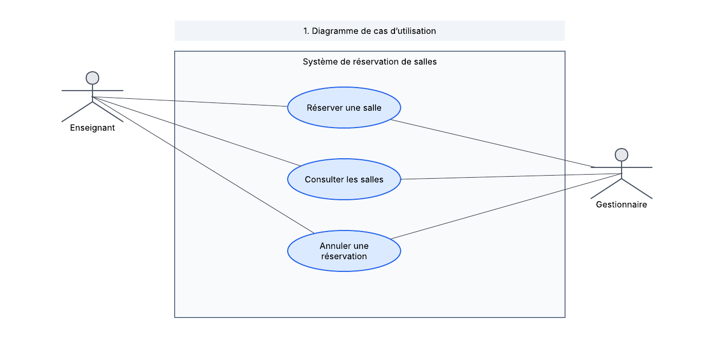
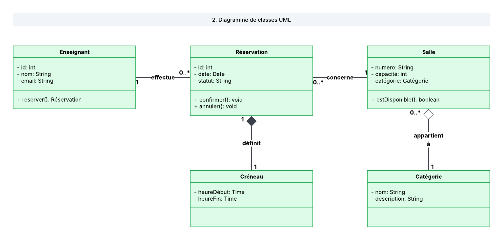
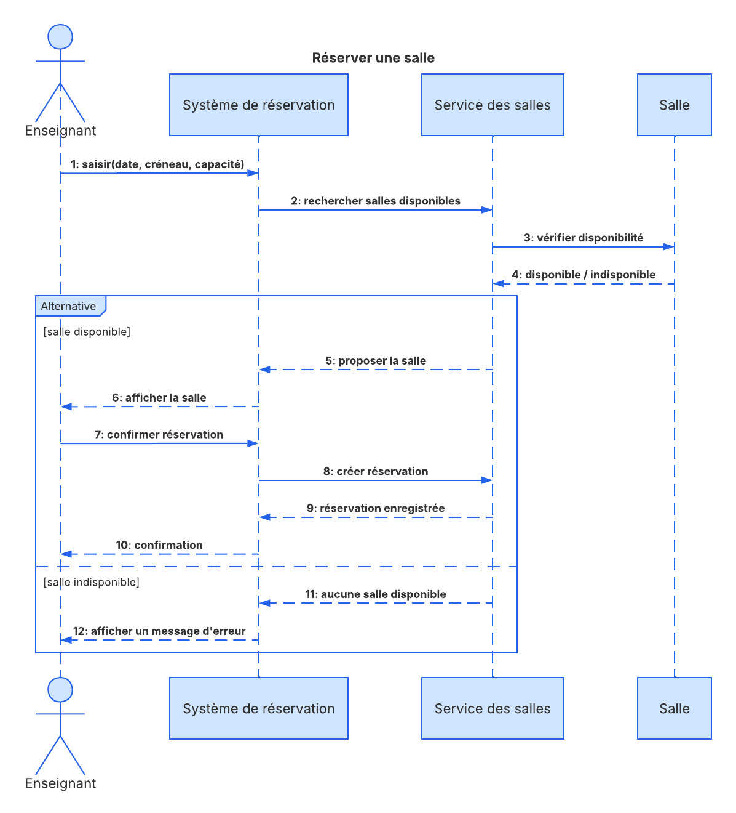

# Système de Gestion de Réservation de Salles Universitaires

Ce projet est une implémentation orientée objet en **C++** d'un système permettant de gérer la réservation des salles (cours, travaux dirigés, soutenances) au sein d'un département universitaire. Il inclut la modélisation **UML** complète (cas d'utilisation, classes, séquence) ainsi que le code source fonctionnel.

## 📋 Fonctionnalités principales

* **Gestion des salles** : Enregistrement des salles avec leur numéro, capacité et catégorie (`COURS`, `TD`, `SOUTENANCE`).
* **Vérification de disponibilité** : Contrôle en temps réel de l'occupation d'une salle pour une date et un créneau horaire donnés.
* **Prévention des conflits** : Blocage automatique des réservations qui se chevauchent sur une même salle.
* **Cycle de vie des réservations** : Création, affichage et annulation des réservations par les enseignants.

## 🏗️ Architecture et Modélisation UML

Le système repose sur une architecture orientée objet respectant les principes d'encapsulation et de séparation des responsabilités :

* **`Salle`** : Représente une salle physique du département.
* **`Enseignant`** : Représente l'utilisateur habilité à effectuer des réservations.
* **`Reservation`** : Associe un enseignant et une salle sur un créneau précis et contient la logique de détection de chevauchement horaire.
* **`SystemeReservation`** : Contrôleur central gérant les collections d'objets (`std::vector`) et les règles métier.

### Diagramme de cas d'utilisation



### Diagramme de classes



### Diagramme de séquence (Réservation d'une salle)



## 🚀 Compilation et Exécution

### Prérequis
* Un compilateur C++ supportant la norme **C++11** ou supérieure (`g++`, `clang++`, ou MSVC).

### Instructions

1. **Cloner ou télécharger le projet** :
   ```bash
   git clone <url-du-depot>
   cd <nom-du-dossier>
   ```

2. **Compiler le code source** (en supposant que le fichier principal se nomme `main.cpp`) :
   ```bash
   g++ -std=c++17 -Wall -Wextra main.cpp -o gestion_salles
   ```

3. **Exécuter le programme** :
   * Sur Linux / macOS :
     ```bash
     ./gestion_salles
     ```
   * Sur Windows :
     ```cmd
     gestion_salles.exe
     ```

## 🧪 Scénario de test inclus

La fonction `main()` exécute automatiquement une batterie de tests démontrant les règles métier :
1. Création de deux salles (`Amphi A` et `B102`) et de deux enseignants (`Jean Dupont` et `Claire Martin`).
2. Réservation valide de la salle `B102` de `8h` à `10h`.
3. Tentative de réservation conflictuelle de `9h` à `11h` sur la même salle (rejetée par le système).
4. Réservation consécutive de `10h` à `12h` (acceptée sans conflit).
5. Annulation de la première réservation et réattribution du créneau libéré.

## 🛠️ Notions abordées

* **Modélisation UML** : Associations, multiplicités, diagrammes de cas d'utilisation, de classes et de séquence.
* **Programmation Orientée Objet (C++)** : Encapsulation, classes énumérées (`enum class`), listes d'initialisation, méthodes constantes (`const`).
* **STL (Standard Template Library)** : Manipulation dynamique avec `std::vector` et algorithmes (`std::remove_if`).

Auteur : [BOTON H. Désiré](https://github.com/Phr34k-777)

