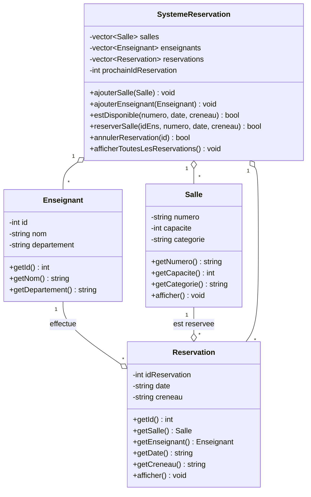

# Gestion d'un Système de Réservation de Salles

Application console développée en C++ permettant de centraliser et d'automatiser la réservation des salles d'un département universitaire tout en empêchant les conflits horaires.

## 📋 Contexte et Énoncé de l'Exercice

Un département universitaire dispose de plusieurs salles destinées aux **cours**, aux **travaux dirigés (TD)** et aux **soutenances**.

* Chaque salle possède un **numéro**, une **capacité** et une **catégorie**.
* Les enseignants peuvent effectuer des réservations pour des **dates** et des **créneaux horaires** précis.
* **Contrainte métier principale :** une salle ne peut pas être réservée par deux enseignants pour le même créneau et la même date.

### Objectifs pédagogiques et fonctionnels

* Identifier les classes nécessaires et leurs associations.
* Réaliser les diagrammes UML (cas d'utilisation, classes, séquence).
* Implémenter les classes en C++ en appliquant l'encapsulation et la gestion de collections d'objets.
* Vérifier la disponibilité d'une salle, enregistrer et annuler une réservation, et bloquer les réservations conflictuelles.

---

## 🏗️ Architecture et Modélisation UML

Le système repose sur quatre classes principales :

1. **`Salle`** : représente une salle physique (`numero`, `capacite`, `categorie`).
2. **`Enseignant`** : représente le demandeur de la réservation (`id`, `nom`, `departement`).
3. **`Reservation`** : associe un `Enseignant` et une `Salle` pour une `date` et un `creneau` donnés.
4. **`SystemeReservation`** : classe gestionnaire qui centralise les collections (`std::vector`) et applique les règles de vérification de conflits.

### Diagramme de classes



### Aperçu textuel

```text
+--------------------+  1      *  +----------------------+  *      1  +--------------------+
|     Enseignant     |<>----------|     Reservation      |----------<>|       Salle        |
+--------------------+            +----------------------+            +--------------------+
| - id: int          |            | - idReservation: int |            | - numero: string   |
| - nom: string      |            | - date: string       |            | - capacite: int    |
| - departement: str |            | - creneau: string    |            | - categorie: string|
+--------------------+            +----------------------+            +--------------------+
                                             ^
                                             | *
                                             |
                                             | 1 (gère)
                                  +----------------------+
                                  |  SystemeReservation  |
                                  +----------------------+
                                  | - salles: vector     |
                                  | - enseignants: vector|
                                  | - reservations: vector|
                                  +----------------------+
                                  | + estDisponible()    |
                                  | + reserverSalle()    |
                                  | + annulerReservation()|
                                  +----------------------+
```

### Règle de conflit

Une réservation est refusée si une réservation existante porte sur la **même salle**, la **même date** et le **même créneau**.

---

## ⚙️ Compilation et exécution

```bash
g++ -std=c++17 -Wall -Wextra -o reservation main.cpp
./reservation
```

---

## 💻 Code Source Complet (`main.cpp`)

Copiez ce code dans un fichier nommé `main.cpp` :

```cpp
#include <iostream>
#include <vector>
#include <string>
#include <algorithm>

// ==========================================
// Classe Salle
// ==========================================
class Salle {
private:
    std::string numero;
    int capacite;
    std::string categorie; // Ex: Cours, TD, Soutenance

public:
    Salle(std::string num, int cap, std::string cat)
        : numero(num), capacite(cap), categorie(cat) {}

    std::string getNumero() const { return numero; }
    int getCapacite() const { return capacite; }
    std::string getCategorie() const { return categorie; }

    void afficher() const {
        std::cout << "Salle " << numero << " [" << categorie
                  << " - Capacite: " << capacite << " places]";
    }
};

// ==========================================
// Classe Enseignant
// ==========================================
class Enseignant {
private:
    int id;
    std::string nom;
    std::string departement;

public:
    Enseignant(int idEns, std::string nomEns, std::string dept)
        : id(idEns), nom(nomEns), departement(dept) {}

    int getId() const { return id; }
    std::string getNom() const { return nom; }
    std::string getDepartement() const { return departement; }
};

// ==========================================
// Classe Reservation
// ==========================================
class Reservation {
private:
    int idReservation;
    Enseignant enseignant;
    Salle salle;
    std::string date;    // Format: JJ/MM/AAAA
    std::string creneau; // Ex: 08h00-10h00

public:
    Reservation(int id, const Enseignant& ens, const Salle& sal,
                const std::string& dt, const std::string& cr)
        : idReservation(id), enseignant(ens), salle(sal), date(dt), creneau(cr) {}

    int getId() const { return idReservation; }
    const Salle& getSalle() const { return salle; }
    const Enseignant& getEnseignant() const { return enseignant; }
    std::string getDate() const { return date; }
    std::string getCreneau() const { return creneau; }

    void afficher() const {
        std::cout << "Reservation #" << idReservation << " | Date: " << date
                  << " (" << creneau << ") | ";
        salle.afficher();
        std::cout << " | Reservee par: Prof. " << enseignant.getNom() << "\n";
    }
};

// ==========================================
// Classe SystemeReservation (Gestionnaire)
// ==========================================
class SystemeReservation {
private:
    std::vector<Salle> salles;
    std::vector<Enseignant> enseignants;
    std::vector<Reservation> reservations;
    int prochainIdReservation = 1;

public:
    void ajouterSalle(const Salle& salle) {
        salles.push_back(salle);
    }

    void ajouterEnseignant(const Enseignant& enseignant) {
        enseignants.push_back(enseignant);
    }

    // Vérifie si une salle est libre à une date et un créneau donnés
    bool estDisponible(const std::string& numeroSalle, const std::string& date,
                       const std::string& creneau) const {
        for (const auto& res : reservations) {
            if (res.getSalle().getNumero() == numeroSalle &&
                res.getDate() == date &&
                res.getCreneau() == creneau) {
                return false; // Conflit détecté
            }
        }
        return true;
    }

    // Enregistre une réservation si aucun conflit n'existe
    bool reserverSalle(int idEnseignant, const std::string& numeroSalle,
                       const std::string& date, const std::string& creneau) {
        // 1. Recherche de l'enseignant
        auto itEns = std::find_if(enseignants.begin(), enseignants.end(),
            [idEnseignant](const Enseignant& e) { return e.getId() == idEnseignant; });

        if (itEns == enseignants.end()) {
            std::cout << "[Erreur] Enseignant introuvable.\n";
            return false;
        }

        // 2. Recherche de la salle
        auto itSalle = std::find_if(salles.begin(), salles.end(),
            [&numeroSalle](const Salle& s) { return s.getNumero() == numeroSalle; });

        if (itSalle == salles.end()) {
            std::cout << "[Erreur] Salle " << numeroSalle << " introuvable.\n";
            return false;
        }

        // 3. Vérification de la disponibilité (contrainte métier)
        if (!estDisponible(numeroSalle, date, creneau)) {
            std::cout << "[Conflit] La salle " << numeroSalle << " est deja reservee le "
                      << date << " sur le creneau " << creneau << ".\n";
            return false;
        }

        // 4. Création et enregistrement
        Reservation nouvelleRes(prochainIdReservation++, *itEns, *itSalle, date, creneau);
        reservations.push_back(nouvelleRes);
        std::cout << "[Succes] Reservation #" << nouvelleRes.getId() << " confirmee pour Prof. "
                  << itEns->getNom() << " (Salle " << numeroSalle << ").\n";
        return true;
    }

    // Annule une réservation via son identifiant
    bool annulerReservation(int idReservation) {
        auto it = std::find_if(reservations.begin(), reservations.end(),
            [idReservation](const Reservation& r) { return r.getId() == idReservation; });

        if (it != reservations.end()) {
            reservations.erase(it);
            std::cout << "[Annulation] Reservation #" << idReservation << " supprimee.\n";
            return true;
        }

        std::cout << "[Erreur] Aucune reservation trouvee avec l'ID #" << idReservation << ".\n";
        return false;
    }

    // Affiche l'ensemble des réservations actives
    void afficherToutesLesReservations() const {
        std::cout << "\n--- LISTE DES RESERVATIONS ACTIVES ---\n";
        if (reservations.empty()) {
            std::cout << "Aucune reservation enregistree.\n";
        } else {
            for (const auto& res : reservations) {
                res.afficher();
            }
        }
        std::cout << "--------------------------------------\n\n";
    }
};

// ==========================================
// Fonction Principale (Scénario de test)
// ==========================================
int main() {
    SystemeReservation systeme;

    // Initialisation des salles
    systeme.ajouterSalle(Salle("A101", 120, "Cours"));
    systeme.ajouterSalle(Salle("B204", 35, "TD"));
    systeme.ajouterSalle(Salle("S01", 20, "Soutenance"));

    // Initialisation des enseignants
    systeme.ajouterEnseignant(Enseignant(1, "Kouassi", "Informatique"));
    systeme.ajouterEnseignant(Enseignant(2, "Mensah", "Mathematiques"));

    std::cout << "=== TESTS DU SYSTEME DE RESERVATION ===\n\n";

    // Test 1 : Réservation valide
    std::cout << "Test 1 : reservation valide\n";
    systeme.reserverSalle(1, "A101", "15/12/2026", "08h00-10h00");

    // Test 2 : Conflit (même salle, même date, même créneau, autre enseignant)
    std::cout << "\nTest 2 : conflit horaire\n";
    systeme.reserverSalle(2, "A101", "15/12/2026", "08h00-10h00");

    // Test 3 : Même salle et même date mais créneau différent
    std::cout << "\nTest 3 : meme salle, creneau different\n";
    systeme.reserverSalle(2, "A101", "15/12/2026", "10h00-12h00");

    // Test 4 : Salle inexistante
    std::cout << "\nTest 4 : salle inexistante\n";
    systeme.reserverSalle(1, "Z999", "15/12/2026", "08h00-10h00");

    // Test 5 : Enseignant inexistant
    std::cout << "\nTest 5 : enseignant inexistant\n";
    systeme.reserverSalle(99, "B204", "15/12/2026", "08h00-10h00");

    systeme.afficherToutesLesReservations();

    // Test 6 : Annulation puis nouvelle réservation du même créneau
    std::cout << "Test 6 : annulation puis re-reservation\n";
    systeme.annulerReservation(1);
    systeme.reserverSalle(2, "A101", "15/12/2026", "08h00-10h00");

    // Test 7 : Annulation d'une réservation inexistante
    std::cout << "\nTest 7 : annulation d'un ID inexistant\n";
    systeme.annulerReservation(42);

    systeme.afficherToutesLesReservations();

    return 0;
}
```

---

## ✅ Résultat attendu à l'exécution

```text
=== TESTS DU SYSTEME DE RESERVATION ===

Test 1 : reservation valide
[Succes] Reservation #1 confirmee pour Prof. Kouassi (Salle A101).

Test 2 : conflit horaire
[Conflit] La salle A101 est deja reservee le 15/12/2026 sur le creneau 08h00-10h00.

Test 3 : meme salle, creneau different
[Succes] Reservation #2 confirmee pour Prof. Mensah (Salle A101).

Test 4 : salle inexistante
[Erreur] Salle Z999 introuvable.

Test 5 : enseignant inexistant
[Erreur] Enseignant introuvable.

--- LISTE DES RESERVATIONS ACTIVES ---
Reservation #1 | Date: 15/12/2026 (08h00-10h00) | Salle A101 [Cours - Capacite: 120 places] | Reservee par: Prof. Kouassi
Reservation #2 | Date: 15/12/2026 (10h00-12h00) | Salle A101 [Cours - Capacite: 120 places] | Reservee par: Prof. Mensah
--------------------------------------

Test 6 : annulation puis re-reservation
[Annulation] Reservation #1 supprimee.
[Succes] Reservation #3 confirmee pour Prof. Mensah (Salle A101).

Test 7 : annulation d'un ID inexistant
[Erreur] Aucune reservation trouvee avec l'ID #42.

--- LISTE DES RESERVATIONS ACTIVES ---
Reservation #2 | Date: 15/12/2026 (10h00-12h00) | Salle A101 [Cours - Capacite: 120 places] | Reservee par: Prof. Mensah
Reservation #3 | Date: 15/12/2026 (08h00-10h00) | Salle A101 [Cours - Capacite: 120 places] | Reservee par: Prof. Mensah
--------------------------------------
```

---

## 🚀 Pistes d'amélioration

* Détecter les **chevauchements** de créneaux (ex. 08h00-10h00 et 09h00-11h00), et pas seulement l'égalité exacte.
* Valider le format des dates et des créneaux.
* Vérifier que la capacité de la salle suffit pour l'effectif prévu.
* Persister les données dans un fichier (CSV ou JSON).
* Ajouter un menu interactif en console.