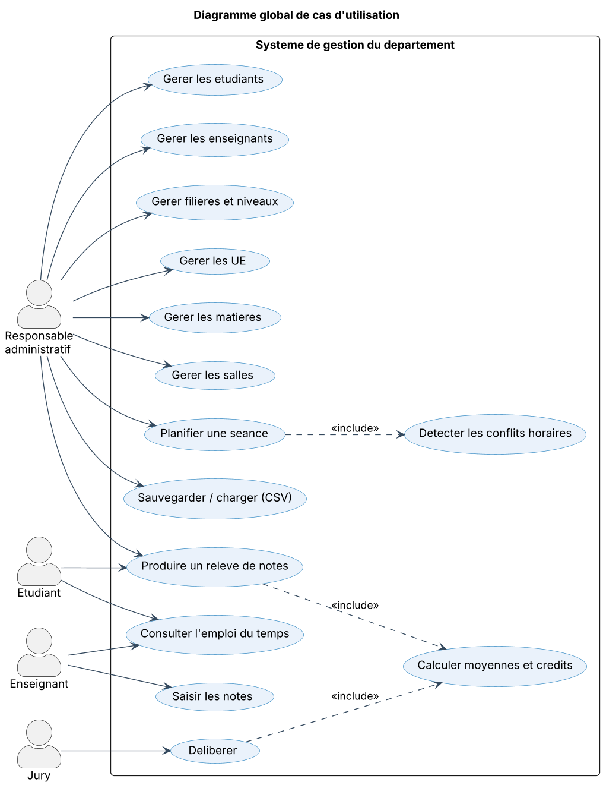
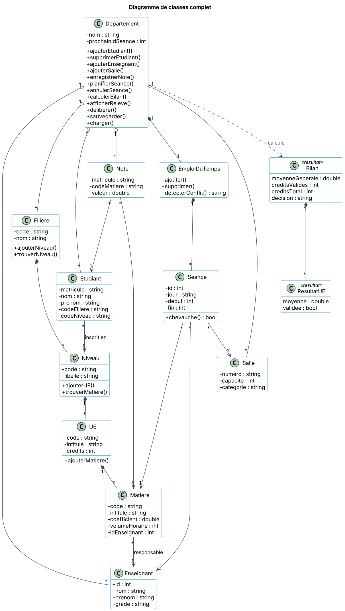
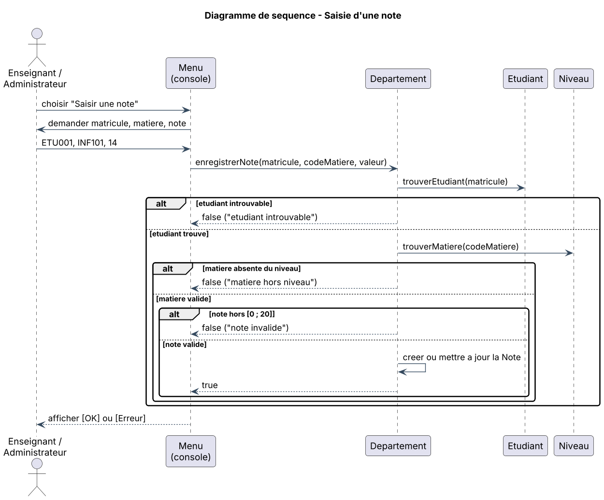
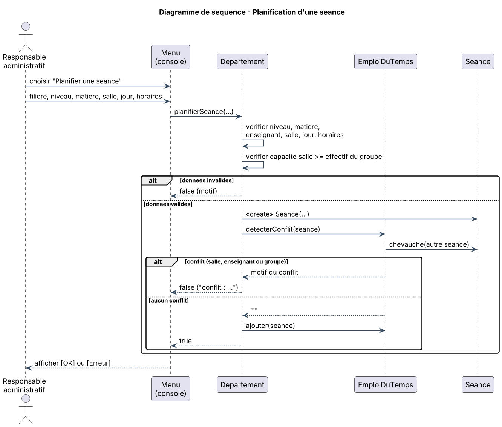
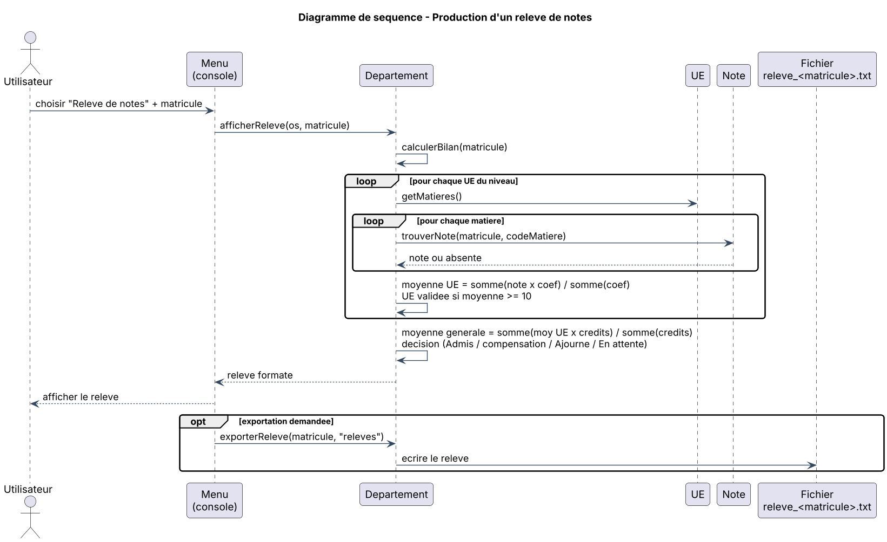
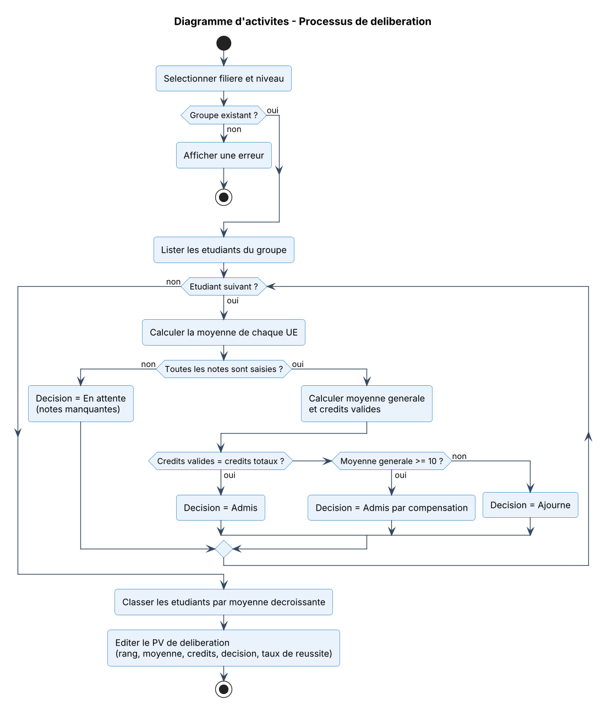
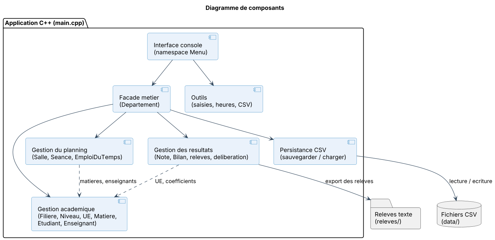
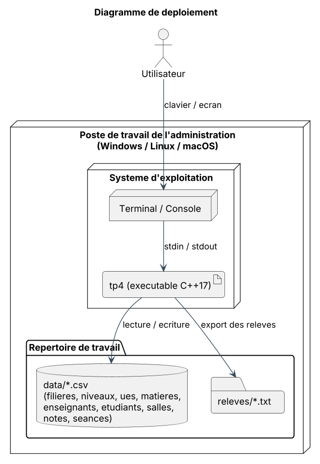

# TP 4 — Système intégré de gestion d'un département universitaire

> Application console en **C++17** pour centraliser la gestion pédagogique et administrative d'un département universitaire : étudiants, enseignants, filières, UE, matières, salles, emplois du temps, notes, relevés et délibération.
> Modélisation UML réalisée avec **PlantUML**. Persistance initiale en fichiers **CSV**.

---

## Table des matières

1. [Présentation du problème](#1-présentation-du-problème)
2. [Fonctionnalités](#2-fonctionnalités)
3. [Règles de gestion](#3-règles-de-gestion)
4. [Modélisation UML](#4-modélisation-uml)
5. [Architecture du code](#5-architecture-du-code)
6. [Persistance des données (CSV)](#6-persistance-des-données-csv)
7. [Compilation et exécution](#7-compilation-et-exécution)
8. [Exemples d'exécution](#8-exemples-dexécution)
9. [Jeu d'essai de démonstration](#9-jeu-dessai-de-démonstration)
10. [Structure du projet](#10-structure-du-projet)
11. [Limites et améliorations possibles](#11-limites-et-améliorations-possibles)

---

## 1. Présentation du problème

Un département universitaire souhaite **centraliser dans une seule application** plusieurs activités administratives et pédagogiques :

* la gestion des **étudiants** et des **enseignants** ;
* la gestion de la **structure académique** (filières, niveaux, unités d'enseignement, matières) ;
* la gestion des **salles** et des **emplois du temps** ;
* la gestion des **notes**, le calcul des **moyennes** et des **crédits validés** ;
* la production des **relevés de notes** et la **délibération**.

### Technologies

| Besoin | Choix |
|---|---|
| Implémentation | C++17 (bibliothèque standard uniquement) |
| Modélisation | UML avec PlantUML |
| Persistance initiale | Fichiers CSV (séparateur `;`) |

---

## 2. Fonctionnalités

| Fonctionnalité attendue | Réalisation dans l'application |
|---|---|
| Gestion des étudiants | Lister, ajouter, supprimer (`ajouterEtudiant`, `supprimerEtudiant`) |
| Gestion des enseignants | Lister, ajouter (`ajouterEnseignant`) |
| Gestion des filières et niveaux | `ajouterFiliere`, `ajouterNiveau`, affichage de la structure |
| Gestion des unités d'enseignement | `ajouterUE` (code, intitulé, crédits) |
| Gestion des matières | `ajouterMatiere` (coefficient, volume horaire, enseignant responsable) |
| Gestion des salles | Lister, ajouter (numéro, capacité, catégorie) |
| Gestion des emplois du temps | `planifierSeance`, `annulerSeance`, `afficherEmploiDuTemps` |
| Gestion des notes | `enregistrerNote` (création ou mise à jour, note comprise entre 0 et 20) |
| Calcul des moyennes et crédits validés | `calculerBilan` |
| Production de relevés de notes | `afficherReleve` et export dans `releves/` |
| Délibération | `deliberer` : PV classé par moyenne, décisions, taux de réussite |
| Persistance | `sauvegarder` / `charger` (fichiers CSV) |

---

## 3. Règles de gestion

**Emploi du temps** — une séance est refusée si elle chevauche une séance existante le même jour et que :

* la **salle** est déjà occupée, ou
* l'**enseignant** de la matière est déjà occupé, ou
* le **groupe** (filière + niveau) a déjà cours.

Elle est également refusée si la **capacité** de la salle est inférieure à l'effectif du groupe, ou si les horaires sont invalides (format `HH:MM`, début < fin).

**Notes et résultats**

* Une note est comprise entre **0 et 20** et ne peut être saisie que pour une matière du niveau de l'étudiant.
* **Moyenne d'une UE** = Σ(note × coefficient) / Σ(coefficients).
* Une **UE est validée** si sa moyenne est supérieure ou égale à **10/20** ; ses crédits sont alors acquis.
* **Moyenne générale** = Σ(moyenne UE × crédits) / Σ(crédits).

**Décision de délibération**

| Condition | Décision |
|---|---|
| Au moins une note manquante | En attente (notes manquantes) |
| Tous les crédits validés | Admis |
| Moyenne générale ≥ 10 (crédits incomplets) | Admis par compensation |
| Sinon | Ajourné |

---

## 4. Modélisation UML

Les sources PlantUML se trouvent dans [`docs/uml/`](docs/uml) et les images dans [`docs/images/`](docs/images).

### 4.1 Diagramme global de cas d'utilisation

Quatre acteurs interagissent avec le système : le **responsable administratif** (gestion et planification), l'**enseignant** (notes, emploi du temps), l'**étudiant** (relevé, emploi du temps) et le **jury** (délibération).



### 4.2 Diagramme de classes complet

`Departement` joue le rôle de classe gestionnaire (façade). La hiérarchie académique est une composition : `Filiere` → `Niveau` → `UE` → `Matiere`. Les résultats de calcul (`Bilan`, `ResultatUE`) sont de simples objets de valeur.



### 4.3 Diagrammes de séquence des opérations principales

**Saisie d'une note**



**Planification d'une séance avec détection de conflits**



**Production d'un relevé de notes**



### 4.4 Diagramme d'activités — processus de délibération



### 4.5 Diagramme de composants



### 4.6 Diagramme de déploiement



### 4.7 Régénérer les images

Avec Java et Graphviz installés :

```bash
java -jar plantuml.jar -tpng -o ../images docs/uml/*.puml
```

---

## 5. Architecture du code

Tout le code est contenu dans [`main.cpp`](main.cpp), organisé en sections :

| Section | Contenu |
|---|---|
| `namespace Outils` | Découpage CSV, saisies sécurisées (texte, entier, réel), conversion des heures, normalisation des jours |
| Classes du domaine | `Enseignant`, `Salle`, `Matiere`, `UE`, `Niveau`, `Filiere`, `Etudiant`, `Note`, `Seance`, `EmploiDuTemps` |
| Objets de valeur | `ResultatUE`, `Bilan` |
| `Departement` | Classe gestionnaire : règles métier, calculs, relevés, délibération, persistance, données de démonstration |
| `namespace Menu` | Interface console interactive |
| `main()` | Chargement des données (CSV ou démonstration) puis boucle du menu |

Principes appliqués : **encapsulation** (attributs privés, accesseurs constants), **composition** pour la hiérarchie académique, **collections `std::vector`**, validation systématique des entrées et retour d'un **motif d'erreur** explicite pour chaque opération refusée.

---

## 6. Persistance des données (CSV)

La sauvegarde crée un dossier `data/` contenant un fichier par entité (séparateur `;`, première ligne = en-tête) :

| Fichier | Colonnes |
|---|---|
| `filieres.csv` | `code;nom` |
| `niveaux.csv` | `filiere;code;libelle` |
| `ues.csv` | `filiere;niveau;code;intitule;credits` |
| `matieres.csv` | `filiere;niveau;ue;code;intitule;coef;volume;idEnseignant` |
| `enseignants.csv` | `id;nom;prenom;grade` |
| `etudiants.csv` | `matricule;nom;prenom;filiere;niveau` |
| `salles.csv` | `numero;capacite;categorie` |
| `notes.csv` | `matricule;matiere;valeur` |
| `seances.csv` | `id;matiere;filiere;niveau;idEnseignant;salle;jour;debut;fin` |

Au démarrage, l'application charge `data/` s'il existe ; sinon elle charge les données de démonstration. Si les fichiers sont corrompus, l'état courant est conservé.

---

## 7. Compilation et exécution

**Prérequis :** un compilateur C++17 (g++ ≥ 8, clang ≥ 7 ou MSVC 2017+).

```bash
g++ -std=c++17 -Wall -Wextra -o tp4 main.cpp
./tp4          # Windows : tp4.exe
```

### Menu principal

```text
=============== GESTION DU DEPARTEMENT ===============
 ETUDIANTS      1. Lister        2. Ajouter       3. Supprimer
 ENSEIGNANTS    4. Lister        5. Ajouter
 SALLES         6. Lister        7. Ajouter
 ACADEMIQUE     8. Filieres, niveaux, UE et matieres
 NOTES          9. Saisir une note
 PLANNING      10. Planifier une seance   11. Annuler une seance
               12. Afficher un emploi du temps
 RESULTATS     13. Releve de notes        14. Deliberation
 DONNEES       15. Sauvegarder (CSV)      16. Charger (CSV)
               17. Recharger les donnees de demonstration
 0. Quitter
=======================================================
```

---

## 8. Exemples d'exécution

### Relevé de notes (option 13, étudiant `ETU002`)

```text
==================== RELEVE DE NOTES ====================
Departement d'Informatique
Etudiant : ETU002 - Houngbo Eric
Filiere  : Informatique | Niveau : Licence 1
---------------------------------------------------------
UE101 - Programmation (6 credits)
   INF101  Algorithmique             coef 2.0  note :  8.00/20
   INF102  Programmation C++         coef 3.0  note :  9.00/20
   => Moyenne UE : 8.60/20 | NON VALIDEE
UE102 - Mathematiques (4 credits)
   MAT101  Analyse                   coef 2.0  note : 14.00/20
   MAT102  Algebre                   coef 2.0  note : 15.00/20
   => Moyenne UE : 14.50/20 | VALIDEE (4 credits acquis)
UE103 - Langues (2 credits)
   ANG101  Anglais technique         coef 1.0  note : 12.00/20
   => Moyenne UE : 12.00/20 | VALIDEE (2 credits acquis)
---------------------------------------------------------
Moyenne generale : 11.13/20
Credits valides  : 6/12
Decision         : Admis par compensation
=========================================================
```

### PV de délibération (option 14, `INFO` / `L1`)

```text
=== PV DE DELIBERATION : INFO - Licence 1 ===
Rang Matricule Nom                     Moy.    Credits   Decision
------------------------------------------------------------------------------
1    ETU001    Sossou Marie            14.13   12/12     Admis
2    ETU004    Agbo Samuel             11.44   10/12     En attente (notes manquantes)
3    ETU002    Houngbo Eric            11.13   6/12      Admis par compensation
4    ETU003    Dossou Fatou            5.97    0/12      Ajourne
------------------------------------------------------------------------------
Admis : 2/4 (50.00 %)
```

### Emploi du temps (option 12, `INFO` / `L1`)

```text
=== EMPLOI DU TEMPS : INFO-L1 ===
#1  Lundi     08h00-10h00  A101    Algorithmique             Dr Kouassi Jean
#2  Lundi     10h00-12h00  A101    Analyse                   Pr Mensah Awa
#3  Mardi     08h00-11h00  B204    Programmation C++         Dr Kouassi Jean
#4  Mercredi  14h00-16h00  B204    Anglais technique         M. Adjovi Paul
```

### Détection de conflits (option 10)

```text
[Erreur] conflit : la salle A101 est deja occupee (seance #1)
[Erreur] horaires invalides (format HH:MM, debut < fin)
[Erreur] la note doit etre comprise entre 0 et 20
```

---

## 9. Jeu d'essai de démonstration

Les données de démonstration (option 17 ou premier lancement) comprennent :

* **3 enseignants**, **3 salles** (`A101` cours 120 places, `B204` TD 35 places, `S01` soutenance 20 places) ;
* la filière **INFO** avec les niveaux **L1** et **L2** ;
* **L1** : `UE101` Programmation (6 crédits), `UE102` Mathématiques (4 crédits), `UE103` Langues (2 crédits), soit 5 matières ;
* **4 étudiants** en L1 couvrant chaque cas de délibération :

| Matricule | Situation | Décision attendue |
|---|---|---|
| `ETU001` | Toutes UE validées | Admis |
| `ETU002` | UE101 non validée, moyenne générale ≥ 10 | Admis par compensation |
| `ETU003` | Notes faibles | Ajourné |
| `ETU004` | Note d'anglais non saisie | En attente |

* **4 séances** planifiées sans conflit.

---

## 10. Structure du projet

```text
.
├── main.cpp                       # Code source C++ complet
├── README.md                      # Ce document
├── docs/
│   ├── uml/                       # Sources PlantUML (.puml)
│   │   ├── 01_cas_utilisation.puml
│   │   ├── 02_classes.puml
│   │   ├── 03_sequence_saisie_note.puml
│   │   ├── 04_sequence_planification.puml
│   │   ├── 05_sequence_releve.puml
│   │   ├── 06_activite_deliberation.puml
│   │   ├── 07_composants.puml
│   │   └── 08_deploiement.puml
│   └── images/                    # Diagrammes exportés (.png)
├── data/                          # Généré : fichiers CSV de persistance
└── releves/                       # Généré : relevés de notes exportés
```

---

## 11. Limites et améliorations possibles

* Les champs CSV ne doivent pas contenir le caractère `;`.
* La saisie des filières, niveaux, UE et matières se fait par les données de démonstration ou par édition des fichiers CSV ; le menu ne couvre pas encore leur création.
* Une seule session de notes par matière (pas de rattrapage).
* Pistes : session de rattrapage, gestion des semestres, export PDF des relevés, interface graphique, base de données (SQLite) à la place des CSV.
